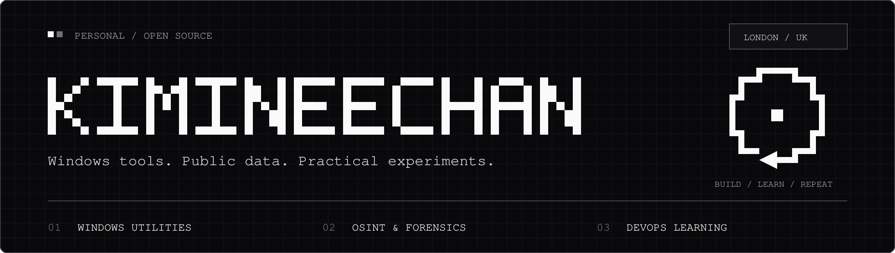

  

  <strong>Windows utility builder. Always learning.</strong>

---

## A little about me

I build Windows desktop utilities and explore how public information can support security research and digital investigations.

I like turning ideas into programs people can download and use, with clear interfaces and source code they can inspect.

## Things I've built

| Project | What it does |
| :--- | :--- |
| **[LazarusBinder](https://github.com/kimineechan/LazarusBinder)** | Combines two standalone Windows EXEs, applies custom icons, and extracts icons from EXE/DLL files. |
| **[LazaVault](https://github.com/kimineechan/lazavault)** | A local password health and rotation assistant. |

## Where my curiosity goes

- **OSINT & infrastructure:** domains, DNS, certificates, and connections between websites.
- **Digital forensics:** understanding what happened through the evidence left behind.
- **Cryptocurrency fraud research:** exploring attribution of websites and related infrastructure.
- **DevOps:** learning how to build, test, release, and maintain software through CI/CD and cloud infrastructure.

## What comes next

More useful desktop tools, deeper work with public data, and stronger DevOps skills. I'm interested in graduate opportunities in cyber security, digital forensics, and DevOps.
